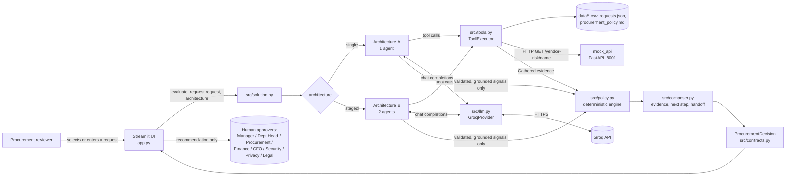
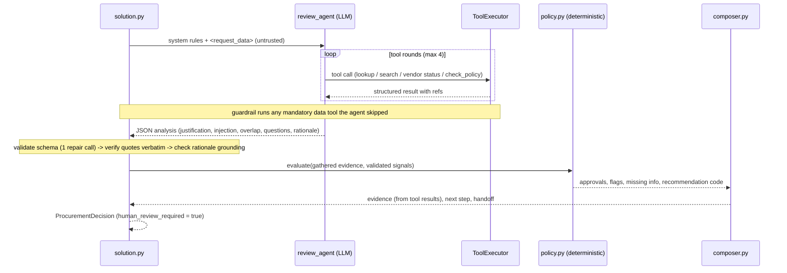
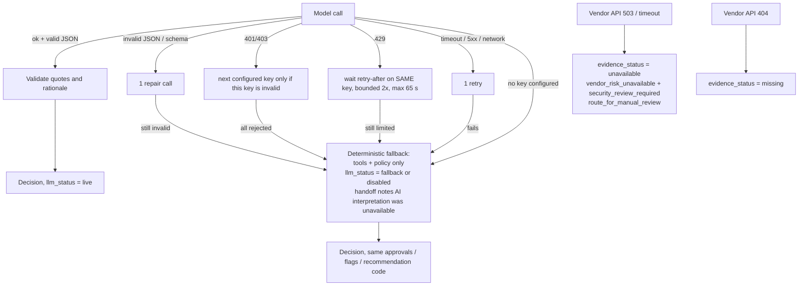

# Architecture, workflow and assumptions

This document describes what is **actually implemented** (module names are real). Diagrams are Mermaid and render on GitHub.

## 1. System context



**Who decides what (the brief's design principle):**

| Layer | Responsibility | Authority |
|---|---|---|
| **AI** (Groq model) | Interprets context: is the stated purpose concrete, is there instruction-like text, does an existing tool plausibly overlap; writes a short rationale and clarifying questions | Advisory. Can only *add* caution (ask for clarification, flag injection) and only with a verbatim quote that exists in the business data |
| **Code** (`policy.py`, `tools.py`, `composer.py`) | Thresholds, budget comparison, approvals, security/privacy/legal triggers, vendor-assessment state, recommendation code, evidence text | Authoritative. Never delegated to the model |
| **Human** | Approve spend, grant exceptions, accept vendor terms, resolve conflicts | Final. Every decision has `human_review_required = true` and a `human_handoff` |

## 2. Tools (all real, all instrumented)

| Tool | Kind | What it does | Source |
|---|---|---|---|
| `lookup_requester_budget` | deterministic lookup | requester → department → budget row; verifies `annual - committed = available` | `employees.csv`, `department_budgets.csv` |
| `search_existing_software` | deterministic search | approved catalog + approved purchases matching vendor / product / category, with *match basis* (never asserts capacity or equivalence) | `software_catalog.csv`, `purchase_history.csv` |
| `get_vendor_status` | external call | registry row + HTTP call to the mock vendor-risk API, 1 retry on transient failure; **503/timeout = `unavailable`, 404 = `missing`**, never treated as favourable or expired | `vendors.csv`, mock API |
| `check_policy` | deterministic engine | spend tier, budget shortfall, security/privacy/legal triggers, approvals, recommendation code | `procurement_policy.md` rules in `policy.py` |

Tools accept only `request_id` and read the request from the run context, so the model cannot change amounts or facts by rewriting arguments. A tool is never executed twice per request (duplicate calls return the cached result and are counted). Mandatory data tools the agent skipped are run by a guardrail and counted as `guardrail_tool_backfills`.

## 3. Architecture A — single agent



## 4. Architecture B — staged, two agents

```mermaid
sequenceDiagram
    participant S as solution.py
    participant A1 as Stage 1: evidence_analyst (LLM + tools)
    participant T as ToolExecutor
    participant P as policy.py
    participant A2 as Stage 2: independent_reviewer (LLM, no tools)
    S->>A1: system rules + <request_data>
    loop tool rounds
        A1->>T: tool calls
        T-->>A1: results
    end
    A1-->>S: EvidenceBrief (key_facts with refs, justification, injection, overlap)
    Note over S: schema-validate brief; drop key_facts whose refs match no tool result
    S->>P: evaluate(evidence) -> deterministic policy result + evidence list
    S->>A2: raw request + validated brief + deterministic evidence + policy result
    A2-->>S: ReviewVerdict (independent justification/injection judgement, unsupported facts, rationale)
    Note over S: Stage 2 is authoritative for interpretive signals; quotes verified; rationale grounded
    S->>P: evaluate(evidence, validated signals) -> same composer path as A
```

**Difference from A, in code:** `agents.run_single` vs `agents.run_staged`; B adds a second model call with a *different role, input and output schema*, a validated intermediate artefact (`EvidenceBrief`), and a reviewer that re-judges instead of trusting Stage 1. Both share tools, policy engine, grounding checks and output contract, so the experiment isolates the orchestration choice.

## 5. Failure and fallback paths



A fallback never changes policy output (tested), is never labelled live, and is visible in the UI and in `metadata.llm_status`.

## 6. Assumptions and interpretations

Official requirements come from the assessment PDF; the items below are **engineering interpretations** where the PDF or policy file is silent.

1. **Reference date** is 2026-09-30, parsed from the policy file. A review is current for 365 days: day 365 is current, day 366 is expired.
2. **Incomplete ≠ expired ≠ unavailable.** `not_completed` → evidence `missing`; past 365 days or API status `expired` → `expired`; HTTP 503/timeout → `unavailable`; no API record (404) → `missing`. Medium/high risk alone triggers nothing.
3. **Missing cost ⇒ no spend tier.** If any required field is missing the recommendation is `request_clarification`; other mandatory triggers (e.g. source-code access) still add their review roles, but no spend-tier approvals are invented.
4. **Business purpose adequacy**: deterministic floor (at least 4 meaningful words after removing instruction-like sentences and filler such as "ASAP"); the model may additionally judge a purpose inadequate, but only with a verbatim quote, and it can only add a clarification request.
5. **Privacy** is triggered by employee/customer PII, or by *sensitive* data (confidential documents, source code, production, credentials) at a vendor that stores data outside the region. A vendor merely being outside the region, or an *unknown* data scope, never triggers it.
6. **Legal** is triggered by: new vendor and spend ≥ $10,000; legal terms not approved/standard (including a vendor absent from the registry); or sensitive data stored outside the region (our reading of "material cross-region issue"). Vendor-wide `processes_personal_data` alone is not a trigger.
7. **Security integrations**: matched on production / cloud-account / git-repository integrations. CRM or "document repository" alone are not triggers; the data-access level covers those.
8. **Conflicts**: registry says approved while the API says expired/incomplete, registry pending while API approved, or differing review dates → `conflicting_vendor_evidence`, Security review, `route_for_manual_review` (policy §5).
9. **Recommendation precedence**: clarification > budget exception > manual review > proceed. When several apply, the next step names all of them.
10. **Existing-tool overlap** is surfaced as a risk flag with the match basis; it never rejects a request and never claims spare capacity.
11. **Policy evidence references** (`#section-4`, `#sections-4-5-7`, …) follow the naming convention used by the public evaluation cases.
12. **Prompt injection** text is detected in the request, catalog/purchase notes, registry notes and API notes. It is flagged (`prompt_injection_detected`) and has no effect on approvals or flags.
13. **Model**: `qwen/qwen3.8-27b` on Groq (reasoning disabled, temperature 0), the model used for the reported evaluation. `openai/gpt-oss-120b` is also supported but its free daily quota (200k tokens) was exhausted during development, so no valid results exist for it. Free-tier limits observed: 8,000 tokens/min and, for qwen, 1,000 output tokens/min, so the client paces itself and retries 429s on the same key; wait time is recorded separately from latency.
